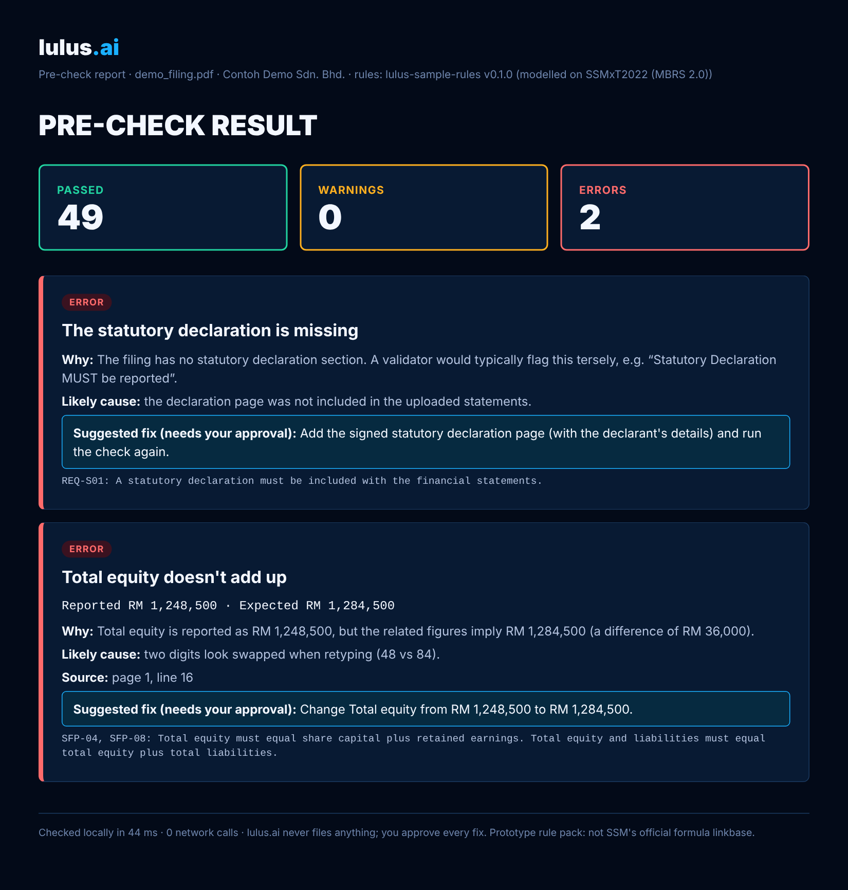
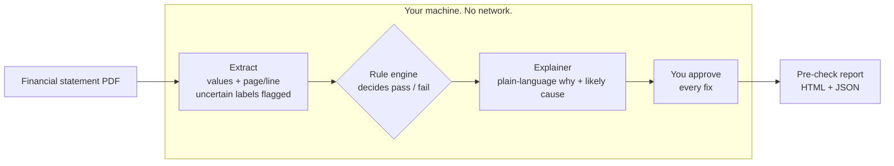

# lulus.ai

**Pass your SSM filing the first time.**
A local-first pre-check that finds MBRS filing errors before they reach mTool, and explains every fix in plain language.

*Lulus* means "pass" in Malay. Built by **GengAI (Actual Intelligence)** for Hackspire Lumina 2026.




## What's in this repository

| Folder | What it is |
| --- | --- |
| [`app/`](app/) | **The lulus.ai web app.** SvelteKit interface plus a Python engine: PDF text layer or EasyOCR → regex extraction → a local `gemma3:4b` model (via Ollama) that proposes values grounded in the source → human review → MBRS XBRL validated by **Arelle against SSM's official `SSMxT_2022v1.0` taxonomy** (`app/taxonomy.zip`). Built by Luqman Al-Hakim; originally at [mathakim29/lulus.ai](https://github.com/mathakim29/lulus.ai). Setup: [`app/README.md`](app/README.md). |
| repository root | **The explainable pre-check and benchmark.** A small, dependency-light rule engine that pinpoints the wrong field and explains the fix, an offline network guard, and a reproducible benchmark on synthetic filings with labelled errors. Runs in seconds, tested in CI. |

---

## The problem

Malaysian companies file annual returns and financial statements to SSM as XBRL through MBRS
(MBRS 2.0 went live in September 2024; SSM's register held 1,590,141 companies at 31 December 2024).
Preparers hit the same walls:

- **Errors surface late.** Rule failures appear only after everything is keyed into mTool.
- **Messages are terse.** "Statutory Declaration for rectification MUST be reported" names no field, reason or fix.
- **Figures are retyped by hand** from PDFs, so typos and swapped digits slip in.
- **Plain AI is risky.** A language model can invent a value or call a filing valid when it is not.

## What lulus.ai does

```
$ python -m lulus check statement.pdf --report report.html

passed 49 · warnings 0 · errors 2 · 44 ms · 0 network calls

[ERROR] Total equity doesn't add up
  Reported RM 1,248,500 · Expected RM 1,284,500
  Why: Total equity is reported as RM 1,248,500, but the related figures imply RM 1,284,500 (a difference of RM 36,000).
  Likely cause: two digits look swapped when retyping (48 vs 84).
  Source: page 1, line 16
  Suggested fix (needs your approval): Change Total equity from RM 1,248,500 to RM 1,284,500.
  Rule: SFP-04, SFP-08
```

Every issue names the **field**, the **reason**, the **rule**, a **suggested fix** and the **source location** in the PDF.

## Quick start

```bash
git clone https://github.com/cendekiaholistikmy/lulus-ai.git
cd lulus-ai
pip install -r requirements.txt

python -m lulus demo                 # builds a synthetic filing with errors, checks it, writes results/demo_report.html
python -m lulus check your.pdf --report report.html --json report.json
python -m pytest -q                  # 12 tests
python tools/benchmark.py            # reproduces the benchmark below
```

Works on text-based PDFs today. Scanned PDFs need OCR (on the roadmap).

## How it works: AI proposes, rules dispose, you approve



| Module | Job |
| --- | --- |
| `lulus/extract.py` | Reads each line of the PDF, maps English or Malay labels to concepts, keeps page and line, flags loose matches for confirmation. |
| `lulus/rules.py` | Deterministic rule engine: required fields, required sections, sign checks and equations (e.g. total equity = share capital + retained earnings). When an equation fails it pinpoints the most likely wrong field by combining keying patterns (swapped digits, one wrong digit, flipped sign, RM'000 scale) with cross-checks against rules that pass. Ties are shown as "also check", never hidden. |
| `lulus/explain.py` | Turns rule results into plain language. Templates today; a small local model can be plugged in later but may only rephrase, never change a result. |
| `lulus/offline.py` | Blocks all outbound network access during a check and counts attempts, so "no data leaves the machine" is measured, not promised. |
| `lulus/report.py` | Writes the HTML and JSON pre-check report. |
| `data/sample_rules.json` | The rule pack, as data rather than code. |
| `tools/make_samples.py` | Generates synthetic filings, clean or with one seeded, labelled error. |
| `tools/benchmark.py` | Scores the engine against the labels. |

## Benchmark (synthetic)

70 synthetic filings: 10 clean and 60 with one seeded error each (fixed seed, reproducible with `python tools/benchmark.py`).

| Measure | Result |
| --- | --- |
| Seeded errors detected | **100%** |
| Exact wrong field pinpointed as main suspect | **95%** |
| Wrong field flagged (main or "also check") | 100% |
| Correct likely cause | **95%** |
| Correct suggested fix | **95%** |
| False alarms on clean filings | **0** |
| Explanations naming field, rule and fix | 100% |
| Mean time per filing | ~50 ms |
| Network calls during checks | **0** |

Full breakdown by error type: [`results/benchmark.md`](results/benchmark.md).

**Read before quoting:** these filings come from our own generator, with a clean layout and one known error each.
Real filings will be harder. The 5% misses are genuinely ambiguous cases (for example a gap that a typo in either
of two lines could explain); lulus.ai names both lines instead of guessing. Next we will run the same filings
through IRIS Instant and mTool, and add authorised real-world samples.

## Responsible by design

- **Human in charge.** Suggested fixes always need the user's approval. lulus.ai never files anything.
- **Local-first.** Checks run on the user's machine with network access blocked (measured: 0 calls).
- **Traceable.** Every value keeps its page and line in the source PDF.
- **Fail-safe.** If the engine can't pin down a cause it says so and shows the raw rule instead of guessing.
- **No invented data.** Samples are synthetic and labelled as such; no real client accounts are used.

## What Round 1 judges told us, and how this repo answers it

| Feedback | In this repo |
| --- | --- |
| Move from synthetic to real data | Rules are data files ready to be replaced by SSM's official linkbase; the benchmark harness is ready for authorised real filings. Synthetic data is labelled as synthetic everywhere. |
| Show validation, errors and limits | `tools/benchmark.py` with ground-truth labels, per-type results and stated misses. |
| Contestability and who sees results | Results stay local; every fix needs approval; ambiguous cases show alternatives. |
| Data quality and preparation | Amount parsing (brackets, RM, "-"), bilingual label mapping, confidence flags, source locations. |

## Limitations

- The root rule pack (`data/sample_rules.json`) is a small sample **modelled on** MBRS-style checks, not SSM's
  official formula linkbase. Official-taxonomy validation lives in `app/` (Arelle + `SSMxT_2022v1.0`); the next
  step is running the root benchmark through that engine too.
- The root prototype reads text-based PDFs only; OCR (EasyOCR) is in `app/`.
- No comparison with IRIS Instant or mTool yet.

## Roadmap

1. **Core engine** (repository root): explainable rule engine, extraction, offline guard, benchmark.
2. **Taxonomy lock** (started in `app/`): field specs read from SSM's `SSMxT_2022v1.0` taxonomy and validated with Arelle.
3. **Local model and review UI** (started in `app/`): local `gemma3:4b` via Ollama, grounded extraction, human review before XBRL output.
4. **Pilot:** 2-3 company secretarial firms, authorised filings, side-by-side benchmark with IRIS Instant and mTool.

## Project structure

```
lulus-ai/
├── app/                # lulus.ai web app: SvelteKit UI, OCR, local LLM, Arelle + SSMxT_2022v1.0
├── lulus/              # engine: extract, rules, explain, offline guard, report, CLI
├── data/               # label mapping (EN/BM) and the sample rule pack
├── tools/              # synthetic sample generator and benchmark
├── tests/              # pytest suite
├── results/            # benchmark.md / benchmark.json
├── docs/               # screenshots
└── .github/workflows/  # CI: tests + benchmark on every push
```

## Team

**GengAI (Actual Intelligence)** · Hackspire Lumina 2026
Web app (`app/`): Luqman Al-Hakim ([mathakim29](https://github.com/mathakim29))
Contact: m.ziqrionlyone@gmail.com

## Sources

- SSM Annual Report 2024, Key Statistical Information (1,590,141 companies at 31 Dec 2024)
- SSM, *Overview of MBRS v2* (2024): MBRS 2.0 go-live, SSMxT2022, mTool 2.1 entry points
- SSM, *SSMxT2022 Architecture Document*

## License

MIT. See [LICENSE](LICENSE).
